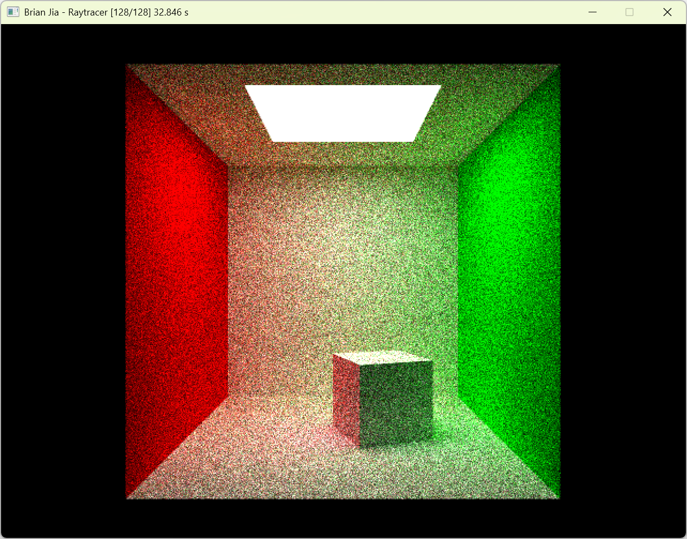

It's a ray tracer that I'm making for fun!

# Timings

Timings are recorded on a Dell Inspiron 16 5645 laptop with an AMD Ryzen 7 8840U CPU, with 40 GB of RAM at 4800 MT/s. 16 GB of 40 GB are in dual-channel mode, the rest are in single-channel mode due to differing RAM stick sizes and speeds (8 GB + 32 GB).

128 rays per pixel are used.

The scene rendered for timings:

| Commit Hash | Runtime  | Notes          |
| ----------- | -------- | -------------- |
| 8ab06df     | 32.846 s | No BVH, no SoA, autovectorization enabled with target-cpu-x86-64-v4 |